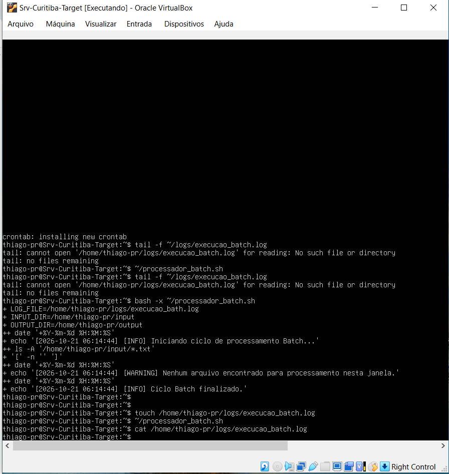
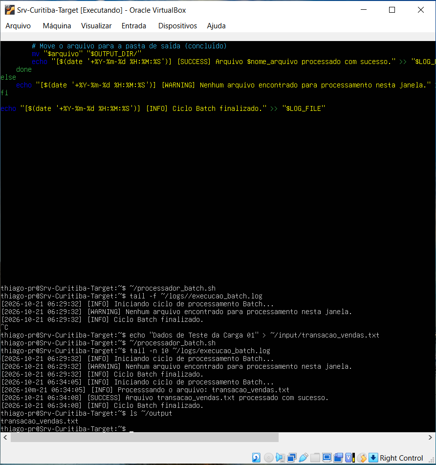

# ⚙️ Home Lab: Sustentação de Ambiente Batch & Monitoramento em Linux

Este repositório contém um **Home Lab prático e realista** projetado para simular o ecossistema de produção de TI de uma grande operação financeira e de recuperação de crédito. O objetivo é demonstrar na prática como funcionam os **ciclos de processamento Batch (em lote)**, a automação com rotinas agendadas no Linux (`crontab`) e a gestão de incidentes reais por meio da leitura sistemática e auditoria de arquivos de logs corporativos.

---

## 🚀 O Cenário do Projeto
O laboratório simula uma esteira de processamento onde parceiros externos depositam arquivos brutos de transações financeiras (`.txt`) em uma pasta de entrada (`input`). O sistema automatizado realiza o seguinte fluxo:
1. Um gatilho temporal (`cron`) dispara o script de processamento a cada 2 minutos.
2. O script mapeia os arquivos, valida sua integridade/existência e inicia a leitura.
3. Cada transação é processada em lote de forma sequencial.
4. O arquivo original é movido para o diretório de arquivos concluídos (`output`).
5. Todas as etapas (Sucessos, Alertas ou Falhas) geram registros enriquecidos em tempo real para um arquivo centralizado de logs (`logs/execucao_batch.log`).

---

## 🛠️ Estrutura do Ambiente Produtivo
O ambiente roda com base em 3 diretórios estruturais mapeados na raiz do usuário do servidor Linux:
* `~/input`: Diretório ativo de escuta (recebimento das cargas de dados).
* `~/output`: Diretório de expurgo e histórico (arquivos processados com sucesso).
* `~/logs`: Repositório dos arquivos de auditoria técnica do sistema.

---

## 📊 Evidências de Execução (Monitoramento em Produção)

### ⚠️ Cenário 1: Janela Batch vazia (Nenhum arquivo encontrado)
Quando o agendador dispara o job na janela de horário prevista, mas a equipe parceira ou o cliente atrasa o envio do arquivo físico, o sistema registra um evento de atenção `[WARNING]`. 

Isso simula o acompanhamento do SLA de recepção em tempo real através do monitoramento de terminal:


### ✅ Cenário 2: Processamento com Sucesso e Validação do Destino
Assim que a carga de dados `transacao_vendas.txt` entra no diretório correto, o monitoramento ativo via `tail -f` exibe dinamicamente a captura do arquivo, o início da rotina interna e a confirmação de escrita de sucesso (`[SUCCESS]`). O comando `ls ~/output` atesta que as regras de governança e expurgo de arquivos foram rigidamente seguidas pelo script:


---

## 💾 Como Clonar e Executar este Laboratório na sua Máquina

Se você deseja baixar os arquivos deste repositório para testar em seu próprio terminal Linux (ou em uma máquina virtual como o VirtualBox), siga as etapas de implantação abaixo:

### 1. Criar a estrutura de pastas no servidor
Crie as pastas necessárias na raiz do seu usuário do Linux:
```bash
mkdir -p ~/input ~/output ~/logs
```

### 2. Configurar o Script
Baixe o arquivo `processador_batch.sh` deste repositório, coloque-o na sua pasta de usuário (`~/`) e garanta que ele tenha a permissão de execução devida no servidor:
```bash
chmod +x ~/processador_batch.sh
```

### 3. Configurar o Agendador (Crontab)
Abra a configuração das tarefas nativas do Linux:
```bash
crontab -e
```
Adicione a linha de agendamento no final do arquivo para simular a esteira contínua rodando a cada 2 minutos (lembre-se de alterar o caminho substituindo `seu_usuario` pelo nome do seu usuário real do sistema):
```text
*/2 * * * * /home/seu_usuario/processador_batch.sh
```

### 4. Operar e Simular a Carga
Em um terminal fixo, inicie o monitoramento como se fosse um Operador de Produção na sua escala de trabalho:
```bash
tail -f ~/logs/execucao_batch.log
```
Em outra janela de terminal, injete uma carga de transações falsas na esteira para testar o comportamento do robô em tempo real:
```bash
echo "Transacao_01;Valor:350.00;Status:Pendente" > ~/input/carga_vendas.txt
```

---

## 🧠 Aprendizados Operacionais adquiridos neste Lab
* **Gestão e Monitoramento de Processos de TI:** Utilização prática de fluxos de entrada e saída voltados para engenharia de sustentação de sistemas críticos.
* **Troubleshooting Sob Pressão:** Investigação detalhada de travamentos, gargalos de permissão ou falhas de gravação ocultas usando parâmetros de debug estruturados no terminal (`bash -x`).
* **Sintaxe Rigorosa de Shell Script:** Manipulação correta de variáveis de ambiente, tratamento de erros silenciosos (`2>/dev/null`) e controle estrito de formatação de strings e carimbos de data/hora (`date`).
